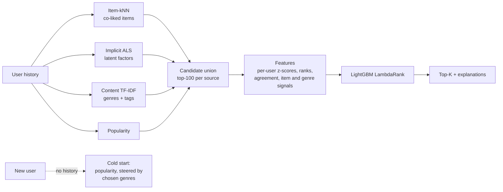

# hybrid-recommender

[](https://github.com/muminr/hybrid-recommender/actions/workflows/ci.yml)

A two-stage recommender system built from first principles: several complementary
retrievers propose candidates, and a LightGBM LambdaRank model learns how to order them.
It includes offline evaluation with a leakage-safe temporal split, cold-start handling,
per-item explanations, and a FastAPI service.

I've led personalization and ML platform teams at enterprise scale. This repo is a
hands-on, from-scratch implementation of the core patterns behind those systems: no
recommender libraries, and every model is small enough to read in one sitting.

## Architecture



| Stage | Component | Why it's there |
|---|---|---|
| Retrieval | **Item-kNN** (`models/itemknn.py`) | "People who liked X also liked Y." Pruned top-k cosine graph with shrinkage; every result is explainable by its neighbour items. |
| Retrieval | **Implicit ALS** (`models/als.py`) | Matrix factorisation for implicit feedback (Hu, Koren & Volinsky 2008), written in NumPy so the closed-form updates are visible. Captures taste beyond direct co-occurrence. |
| Retrieval | **Content TF-IDF** (`models/content.py`) | Genres and user tags. The only retriever that can surface items nobody has interacted with yet. |
| Retrieval | **Popularity** | Baseline, plus cold-start fallback. |
| Ranking | **LightGBM LambdaRank** (`hybrid.py`) | Optimises NDCG directly and learns how much to trust each retriever for each kind of user and item, instead of hand-tuned blend weights. |
| Serving | **FastAPI** (`service.py`) | Ranked lists with reasons, a cold-start path for new users, and similar-item lookups. |

## Results

### MovieLens ml-latest-small (real data)

610 users, 9,742 movies, 100,836 ratings. Temporal per-user holdout, 591 evaluated users.
Reproduce with `make data && make eval`, or see
[`reports/results_ml-latest-small.md`](reports/results_ml-latest-small.md).

| Model | Recall@10 | NDCG@10 | HitRate@10 | Coverage |
|---|---|---|---|---|
| Popularity | 0.077 | 0.078 | 0.316 | 0.009 |
| Content TF-IDF | 0.006 | 0.005 | 0.034 | 0.185 |
| Item-kNN | 0.117 | 0.104 | 0.442 | 0.030 |
| Implicit ALS | 0.132 | 0.114 | 0.496 | 0.064 |
| Equal-weight blend | 0.127 | 0.115 | 0.486 | 0.028 |
| Two-stage hybrid (LightGBM) | 0.127 | 0.112 | 0.481 | 0.064 |

**Honest read:** on real data the learned ranker **ties** ALS and the blend. Paired
bootstrap 95% confidence intervals on the NDCG@10 differences all include zero
(hybrid − ALS: −0.001 [−0.011, +0.008]). Every personalized model clears the popularity
baseline by about 45%. The hybrid keeps ALS-level coverage, more than double the blend's,
at the same accuracy. That's the case for it today, not an accuracy win.

Why the ranker doesn't pull ahead yet, and what I'd try next:
- **Thin ranker training data.** With 610 users, the label window gives a few thousand
  positives. Learning-to-rank earns its keep at much larger scale.
- **Weak content signal.** Only about 3.7k tags across 9.7k movies, so the content
  retriever contributes little beyond genres.
- **Session-style timestamps.** Many MovieLens users rated dozens of movies in one
  sitting, so "the future" in a temporal split is less distinct than in real viewing logs.

### Synthetic data (MovieLens scale, stronger structure)

610 users, 2,000 items, ~100k ratings from a generator with real genre and latent-factor
structure ([`reports/results_synthetic.md`](reports/results_synthetic.md)). Here the
ranker wins: **+17% NDCG@10** over the best single retriever and **+11%** over the blend.
The gap between the two datasets is the lesson: a method that wins on clean synthetic
data still has to prove itself on real data.

### Why the evaluation split matters

The same ALS model scores **NDCG@10 = 0.285 on a random split** and **0.114 on the
temporal split**. The random split lets the model train on a user's later ratings and
"predict" earlier ones, so it overstates quality by about 2.5×. Every number in this
README uses the temporal split.

## Quickstart

```bash
pip install -e ".[dev]"
make test              # 30 tests, ~5s, no download needed
make eval-synthetic    # full offline evaluation on synthetic data

make data              # MovieLens ml-latest-small (research licence, never committed)
make eval              # offline evaluation on real data
make train             # fit on all ratings -> artifacts/model.joblib
make serve             # http://localhost:8000/docs
```

If `make data` fails on a TLS error, download `ml-latest-small.zip` from
[grouplens.org](https://grouplens.org/datasets/movielens/latest/) and run
`python scripts/download_movielens.py --zip path/to/ml-latest-small.zip`.

## API

```bash
curl "localhost:8000/recommendations/42?k=3"
```

```json
{
  "user_id": 42,
  "strategy": "hybrid_ranker",
  "items": [
    {
      "movie_id": 592,
      "title": "...",
      "genres": "Adventure|War|Western",
      "reasons": [
        "Viewers with similar taste liked it",
        "Matches your overall taste profile",
        "Because you liked <title A> and <title B>"
      ]
    }
  ],
  "latency_ms": 36.3
}
```

| Endpoint | Purpose |
|---|---|
| `GET /recommendations/{user_id}?k=` | Ranked, explained recommendations. Unknown users fall back to cold start. |
| `GET /recommendations?genres=Comedy&genres=Romance` | Brand-new user steered by genres picked at sign-up. |
| `GET /items/{movie_id}/similar` | Item-to-item similarity ("more like this"). |
| `GET /health` | Readiness and catalogue size. |

## Design decisions

**Temporal split, not random.** Each user's most recent 20% of ratings is the test
set. A random split lets the model see the future, which inflates every metric and hides
the bias toward popular items.

**The ranker never trains on labels its retrievers saw.** The training window is split
again in time: retrievers fit on the earlier part, and the ranker learns to predict the
later part. Retrievers are then refit on the full window for serving.

**Scale-free features, a bug I hit and fixed.** The first version fed raw retriever
scores to the ranker, and the hybrid scored *below* the simple blend. The cause was
train/serve skew. Item-kNN scores grow with history length and popularity counts grow
with traffic, so the thresholds the ranker learned on the smaller training window were
wrong at serving time. Replacing raw scores with per-user z-scores, ranks and popularity
percentiles fixed it. A test (`test_features_are_scale_free`) keeps it fixed.

**Coverage is reported next to accuracy.** Popularity scores respectably on accuracy
while recommending 2% of the catalogue. Optimising for accuracy alone pushes a system
toward the same hits for everyone.

**Explanations come from the models themselves.** Each recommendation lists which
retrievers proposed it, and the item-kNN graph names the specific titles in the user's
history that drove it.

## Limitations and next steps

- ALS hyperparameters were picked from a small grid on synthetic data. For real data,
  tune them on a validation window before trusting the comparison.
- Retrieval is brute-force scoring, which is fine at 10k items. At catalogue scale,
  swap in an approximate-nearest-neighbour index (FAISS or ScaNN) over the ALS
  embeddings.
- Features are computed at request time. In production they'd come from a feature store
  with point-in-time correctness.
- Offline metrics only. The natural next step is shadow scoring against a live baseline,
  then an A/B test on engagement.

## Project layout

```
src/hybrec/
  data.py          loading, temporal split, synthetic MovieLens-format generator
  models/          popularity, itemknn, als, content (each a few dozen lines)
  hybrid.py        candidate union, features, LambdaRank training and serving
  metrics.py       Recall / NDCG / HitRate / coverage
  evaluate.py      offline evaluation CLI
  train.py         fit and save a servable artifact
  service.py       FastAPI app
tests/             30 tests: data, metrics, models, hybrid, API
```

## License

MIT. MovieLens data is © GroupLens and is not included or redistributed.
